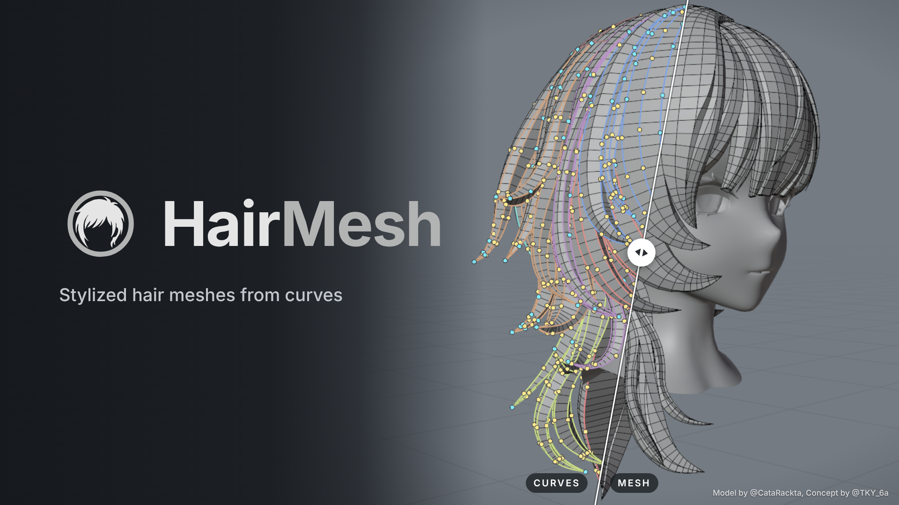
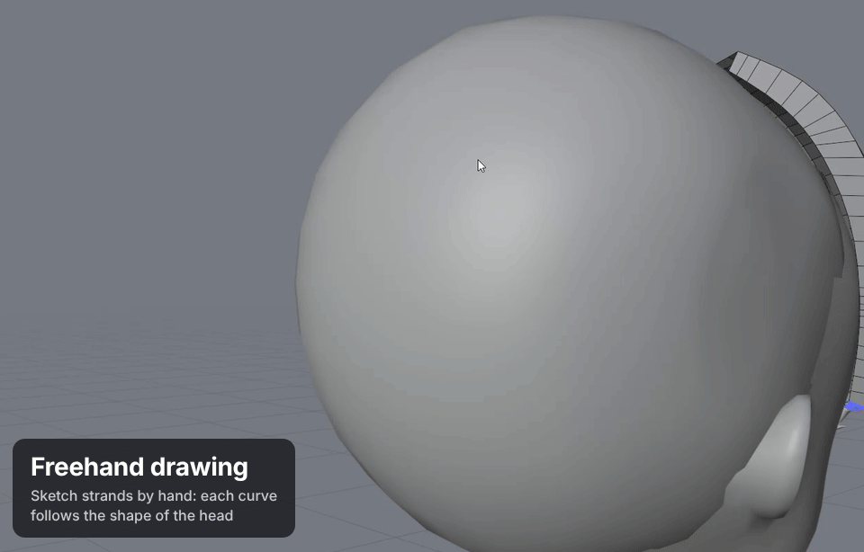

# HairMesh

HairMesh is a port of [Stylized HairMesh Creator](https://catarackta.netlify.app/) by **catarackta** to Blender, made
with the author's permission. The method and the original application are theirs.

Stylized and anime hair for Blender. Draw curves over a head, stretch walls between them to form locks, and convert
everything to a clean quad mesh with evenly spread loops.

## What it does

- Draw curves on a head, point by point or freehand. Walls stretch between neighboring curves and form locks.
- Convert the locks to quad meshes. Keep editing the curves after the conversion and convert again: only the changed
  meshes are rebuilt. Switch the whole project between the curves (Live) and the meshes (Baked).
- Shape the hair with guides, crowns, junctions, symmetry and modifiers (tube, mask, thickness, twist, noise, curls,
  fill, density).
- Work inside Blender: the project lives in the `.blend` file, and `.hairmesh` files import directly.

Requires Blender 5.1 or later.

## Install

- **From Blender Extensions:** in Blender, open Edit > Preferences > Get Extensions, search for HairMesh and install it.
  Blender keeps it up to date.
- **From a zip:** download `hairmesh-<version>.zip` from the [Releases](https://github.com/riel-gab/hairmesh/releases)
  page, drag it into Blender and confirm.

## First steps

1. Select the head mesh. In Object Mode, press **Shift+Alt+H** to turn the tool on, then create a New Project: the
   active mesh becomes the head.
2. Press **D** for the HairMesh Menu, **Q** for the sub-tools, **O** for the project's Outliner.
3. Create a group, pick Draw and click over the head to place a curve. Draw a second one beside it.
4. Select both curves, press **Shift+right-click** and choose Walls / Lock > Create Wall: the wall between them is a
   lock.
5. Press Convert, then Confirm, to turn the locks into a mesh.

The [Getting started](docs/getting-started.md) page walks through it step by step.

To learn from a finished model, download the example file from the author's page, <https://boosty.to/catarackta>,
and import it with File > Import. The example does not ship with the add-on.

## Documentation

- [Getting started](docs/getting-started.md): from an empty scene to the first converted lock.
- [Workflow](docs/workflow.md): curves, walls, conversion, groups, guides, crowns, symmetry and modifiers.
- [Tools](docs/tools.md): every sub-tool, the menus and the pies.
- [Shortcuts](docs/shortcuts.md): every key, generated from the code.
- [Troubleshooting](docs/troubleshooting.md): common problems and how to report a bug.

Found a bug or have an idea? [Open an issue](https://github.com/riel-gab/hairmesh/issues).

## Credits

- Original application and method: catarackta, <https://catarackta.netlify.app/>.
- Port to Blender: Riel.

See [CREDITS.md](CREDITS.md).

## License

GPL-3.0-or-later ([LICENSE](LICENSE)), with the written permission of the original author. Icons: CC0-1.0.

HairMesh is free. If it helps you, you can leave a tip on [Ko-fi](https://ko-fi.com/rielart).
