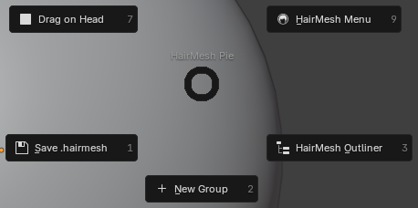
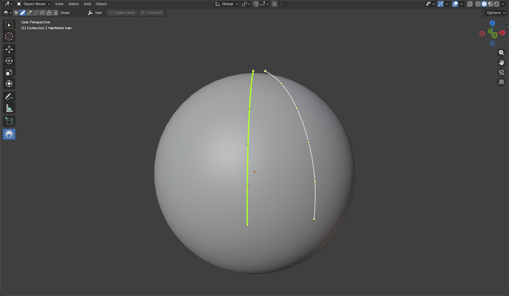
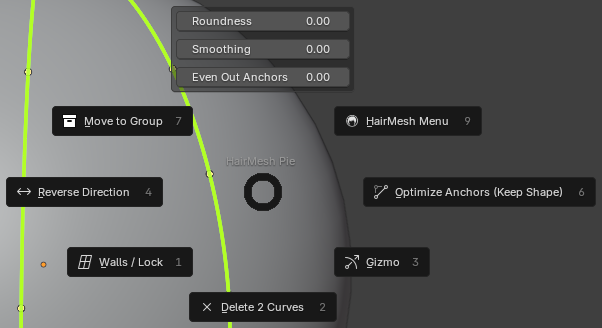
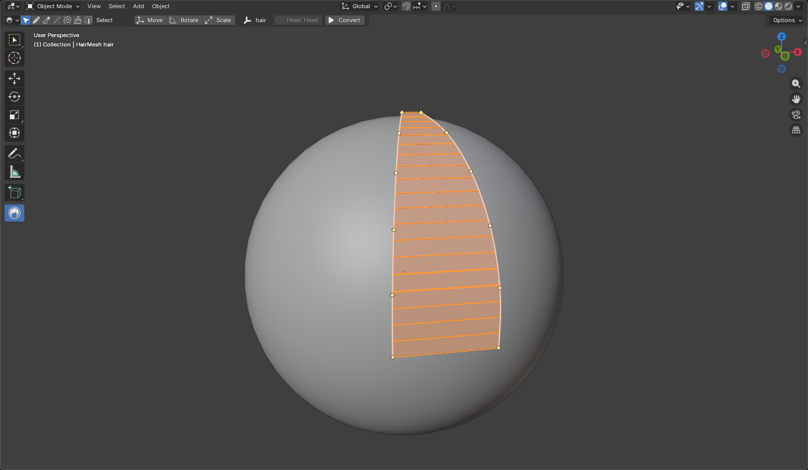
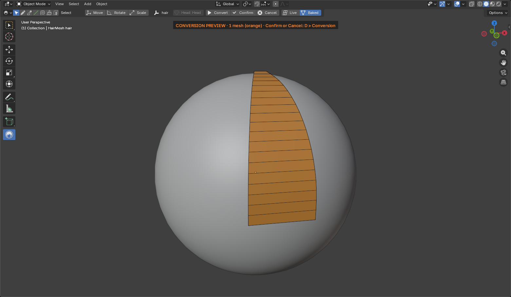
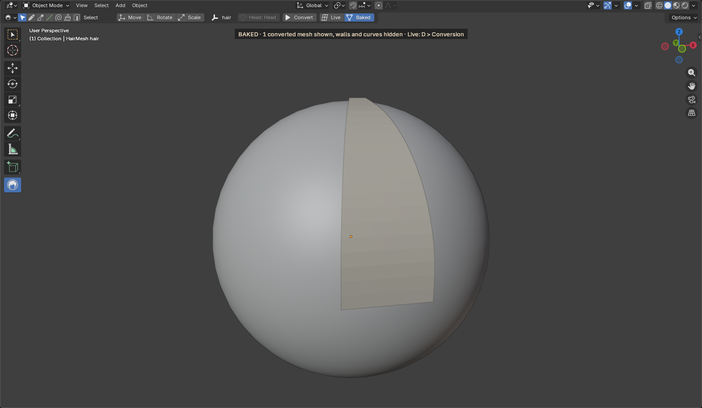
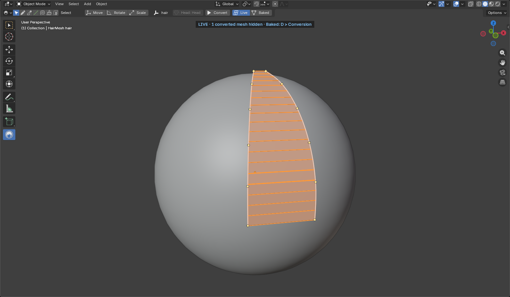

# Getting Started

This page takes you from a fresh install to your first converted lock: two curves on a head, a wall between them,
and a clean quad mesh.

HairMesh is a port of [Stylized HairMesh Creator](https://catarackta.netlify.app/) by catarackta, made with the
author's permission. It needs Blender 5.1 or later.

## 1. Install

Pick one:

- **From extensions.blender.org.** Open Edit > Preferences > Get Extensions, search for **HairMesh** and click
  Install. Blender then keeps it up to date.
- **From the zip.** Download `hairmesh-<version>.zip` from the
  [Releases](https://github.com/riel-gab/hairmesh/releases) page, drag it into the Blender window and confirm.

## 2. Turn the tool on

1. Make sure you are in **Object Mode**.
2. Press **Shift+Alt+H**. The HairMesh tool becomes the active tool in the toolbar.
3. Press **Shift+Alt+H** again at any time to go back to the tool you used before.

This is the only global shortcut. Every other HairMesh key works only while the tool is active. See
[Shortcuts](shortcuts.md) for the full list.

Three keys open everything else:

- **D** opens the HairMesh Menu, a pop-up with tabs.
- **Q** opens the sub-tool pie (Select, Draw, Scissors, and more).
- **O** opens the HairMesh Outliner.

## 3. Start a project with a head

HairMesh draws hair on a mesh you choose as the head.

1. Add or open a head mesh and click it so it is the active object.
2. In the tool header, click **New Project...** (it is also in the **Project** tab of the HairMesh Menu).
3. Give the project a name. Leave **Head** checked so the active mesh becomes the head.
4. Click OK.

The project is stored inside your `.blend` file. Save the `.blend` and the hair comes with it.

If you skipped the head, select the head mesh later and click **Set Head** in the Project tab (once a head is set, the
button shows **Head:** and the head's name). Click it again after you move or edit the head.

## 4. Make a group

Walls are converted group by group, so start with a group.

1. With nothing selected, press **Shift+RMB** to open the pie.
2. Click **New Group**, at the bottom of the pie (or press **2** on the numpad while the pie is open).

<!-- claims gs-pie: groups=0 curves=0 pie.S="New Group" -->

The new group is selected and ticked for conversion. New curves go into it.

## 5. Draw two curves

1. Press **2** to switch to the Draw sub-tool. The keys **1** to **5** switch sub-tools directly, without opening a
   pie; the **Q** pie has them too (Draw is on its right).
2. Click on the head where the lock starts, then keep clicking along its path. Each click places an anchor.
3. Press **Enter** (or right-click) to finish the curve.
4. Draw a second curve beside the first one, a short distance away.

<!-- claims gs-draw: curves=2 walls=0 subtool=DRAW -->

A curve needs at least two anchors. A click off the head places the anchor on a plane facing the view.

Prefer to sketch? The Draw page of the HairMesh Menu has a **Freehand** mode: drag a stroke and it becomes a curve. See
[Tools](tools.md#draw).

## 6. Stretch a wall between them

1. Press **Esc** to go back to Select.
2. Click the first curve, then **Shift+click** the second one.
3. Press **Shift+RMB**. **Walls / Lock** is at the bottom left of the pie.

<!-- claims gs-wall-pie: selected_curves=2 subtool=SELECT pie.SW="Walls / Lock" -->

4. Open **Walls / Lock** and click **Create Wall**.

<!-- claims gs-wall: curves=2 walls=1 walls_shown=1 -->

A wall now joins the two curves. It is selected: its grid shows in the orange of the selection. Neighboring walls form
a lock. Click the wall to see its settings in the Selection
tab of the HairMesh Menu (D): Bulge, Width Segments, Clean Topology, and more. The HairMesh Outliner and the sheets
list each wall by its default name, **Surface 1**, **Surface 2**…, the name the original application gives it.

## 7. Convert

1. Press **D** and open the **Conversion** tab. Your group is in the list, ticked.
2. Click **Convert**.
3. The new mesh appears, solid orange, with the **CONVERSION PREVIEW** banner at the top of the view. This is a
   preview: nothing is kept yet. The view is **Baked**: the wall and the curves are hidden while the mesh shows. Adjust
   the sliders (Loop Step, Deviation, Tips…) if you like: the preview follows.

<!-- claims gs-preview: pending=1 confirmed=0 meshes_shown=1 color=orange view=baked walls_shown=0 -->

4. Click **Confirm** (the check mark next to Convert) to keep it, or **Cancel** (the X) to drop it. The confirmed mesh
   turns a light hair color, and the view stays **Baked**.

<!-- claims gs-confirmed: pending=0 confirmed=1 meshes_shown=1 color=light view=baked walls_shown=0 -->

Convert, Confirm and Cancel are also in the tool header. While the preview is pending, they are in the Shift+RMB pie
with nothing selected too.

## 8. Live and Baked

Once there is a converted mesh (a pending preview counts), two buttons switch the view of the whole project:

- **Live** shows the walls and curves and hides the converted meshes. Use it to keep editing.
- **Baked** shows the converted meshes and hides the walls and curves they came from.

<!-- claims gs-live: view=live meshes_shown=0 walls_shown=1 curves=2 -->

You find them in the tool header, as icons next to Convert in the Conversion tab, and in the Shift+RMB pie with
nothing selected.

The confirmed mesh does not change when you edit the curves. After an edit, the Conversion tab tells you how many
meshes changed. Click **Convert** again: only those are rebuilt.

## Next steps

- [Workflow](workflow.md): groups, guides, crowns, symmetry, modifiers and more, task by task.
- [Tools](tools.md): every sub-tool, menu and pie.
- [Shortcuts](shortcuts.md): every key.
- [Troubleshooting](troubleshooting.md): when something does not respond, and how to report a bug.

Want to study a finished model? Download the example file from the author's page, <https://boosty.to/catarackta>,
and import it with File > Import > HairMesh Project (.hairmesh). The example does not ship with the add-on.
