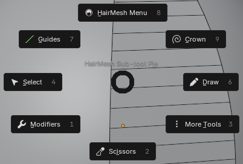
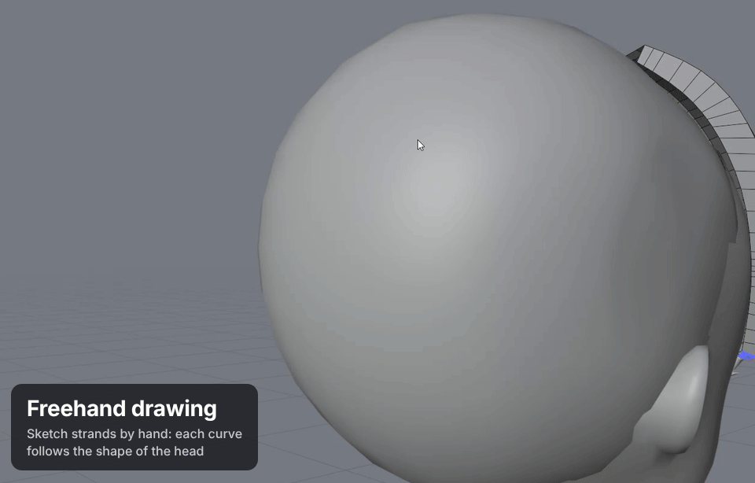
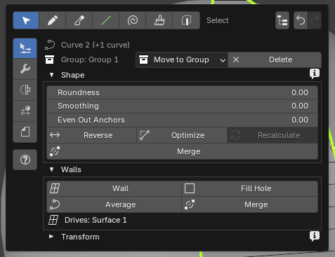

# Tools

HairMesh is one tool in the Object Mode toolbar, with sub-tools inside it. This page says what each sub-tool, menu and
pie is for. For the order of work, see [Workflow](workflow.md). For every key, see [Shortcuts](shortcuts.md).

Turn the tool on with **Shift+Alt+H** in Object Mode. Its header shows the sub-tools as icons, the HairMesh Menu, the
project, **Set Head** (once a head is set, it shows **Head:** and the head's name), **Convert** and, once there are meshes, **Live** and **Baked**.

## Switching sub-tools

Press **Q** for the sub-tool pie. Click an item, or press the number the pie shows beside it on the numpad:

| Direction | Numpad | Item |
|---|---|---|
| Left | 4 | Select |
| Right | 6 | Draw |
| Bottom | 2 | Scissors |
| Top | 8 | HairMesh Menu |
| Top left | 7 | Guides |
| Top right | 9 | Crown |
| Bottom left | 1 | Modifiers: the HairMesh Menu on its Modifiers tab |
| Bottom right | 3 | More Tools: Brush, Edges, HairMesh Outliner |

<!-- claims subtool-pie: pie.W=Select pie.E=Draw pie.S=Scissors pie.N="HairMesh Menu" pie.SE="More Tools" -->

Without opening the pie, these keys switch directly (the number row, not the numpad):

| Key | Sub-tool |
|---|---|
| 1 | Select |
| 2 | Draw |
| 3 or K | Scissors |
| 4 | Guides |
| 5 | Crown |
| 6 | Modifiers (the HairMesh Menu on its Modifiers tab) |
| M | Brush |
| V | Edges |

The icons in the tool header switch sub-tools too. **Esc** goes back to Select from most sub-tools.

## Select

For picking and moving anchors, curves, walls, guides, crowns and converted meshes.

- **Click** selects; **Shift+click** adds; a **box** selects anchors; a click in empty space clears the selection.
- **Double-click** a curve to select its anchors (again: the curve).
- **Drag an anchor** to move it. Hold **Shift** to slide it along the curve, **Alt** to follow the head surface.
- **Right-click a curve** to insert an anchor there.
- **B + drag** sets the smoothness of the selected anchors.
- **C** is Circle Select.
- **G**, **R**, **S** move, rotate and scale the selection (anchors, curves, walls or groups). Converted meshes in the
  selection move with it. X, Y and Z lock an axis; type a value; **Esc** cancels.
- **F** frames the selection.

**Drag on Head** (Viewport tab) makes dragged anchors follow the head surface all the time.

### The gizmo

Press **E** for the Move gizmo on the selection. The **Gizmo** menu (bottom right of the Shift+RMB pie, when the
selection can move) and the **Transform** block of the sheets also have the Rotate and Scale gizmos, **World** or
**Local** axes, **Lock X / Y / Z**, and **Duplicate**. While dragging a handle, **Ctrl** scales uniformly and **Shift**
gives finer steps.

## Draw

For drawing new curves on the head. Press **2**.

The Draw page (HairMesh Menu, Selection tab) sets:

- **New Curves Go To**: the group that gets the next curve, with **Change Group**;
- **New Anchors**: **Smooth** or **Sharp**;
- **Mode**: **Anchors** or **Freehand**.

### Anchors mode

Each click places an anchor on the head. A ghost line follows the cursor. **Enter** or a right-click finishes the
curve; **Esc** finishes it and goes back to Select. Off the head, the anchor goes on a plane facing the view.

### Freehand mode

Drag a stroke. When you release, it becomes one curve. **Esc** during a stroke cancels it. Between strokes you can
navigate, undo and open pies as usual.

Freehand has three more settings:

- **Project On**: **Surface** lands on what is nearest to the camera (the head or a mesh), to add a layer over the
  hair; **Head** lands on the head alone, to draw close to the skull. It needs a visible head.
- **Distance from Head**: how far the finished curve sits off the surface.
- **Simplify**: fewer anchors and a smoother curve.

To join two strokes with a wall, select both, then **Walls / Lock** in the Shift+RMB pie.

## Scissors

For cutting. Press **3** or **K**. The header and the page have two modes.

- **Curve:** pick curves (click, or select them before), then drag a line across them. A pie asks how: **Split into Two
  Curves**, **Split, Delete the Upper Part**, or **Split, Delete the Lower Part**. The shape is kept. The walls of the
  cut curves are deleted; make new ones from the pieces.
- **Wall:** click the wall to cut. Click one of its curves where the cut starts, click on the wall to add anchors, and
  click its other curve to end the cut. Press **Enter** (or Shift+RMB > **Cut**) to split the wall in two along a new
  curve. **Backspace** removes the last anchor; **Esc** cancels.

## Guides

For steering the loops of the conversion. Press **4**. Three modes:

- **Line:** drag a line across the selected curves (none selected: every visible one).
- **NURBS Disc:** click on the hair for a ring around the head at that height. **Create NURBS Disc** makes one around the
  selected curves.
- **Pencil:** hold the left button and draw a loop around the hair. **Enter** closes it, **Esc** cancels.

The page shows the sheet of the selected guide (Influence Radius, Blend, Loop Density, Priority; for a disc, the ring
radii and **Reset Deformations**), or **Settings for New Guides**. The Shift+RMB pie of a guide line has **Select
Crossed Curves**.

## Crown

For the hair around the whorl and the parting. Press **5**.

- Click on the head where the whorl should be, or click **Create Crown**.
- **Symmetric (New Crowns)** mirrors new crowns across the head's center.
- Drag a lock curve's end onto a connector to open the Attach pie. **Ctrl+drag** slides an attached anchor; **Ctrl+click**
  detaches it.

The Shift+RMB pie of a crown selects its **Parting Line**, **Lower Connector** and **Crown Curves**, and has **+ Crown
Curve**, symmetry and **Rings**.

## Brush

For reshaping many anchors at once. Press **M**, or More Tools in the Q pie.

- **LMB drag:** the anchors under the circle follow, softer toward its rim.
- **Shift:** smooth. **Ctrl:** inflate the lock. **Ctrl+Alt:** shrink it.
- **Mode**: **Screen** moves everything inside the circle; **Surface** moves only the hair nearest the touched point.
- **[** and **]** or **F** change the radius, **Shift+F** the hardness, **Ctrl + right drag** both.

With curves or a NURBS disc selected, only their anchors move. **Esc** goes back to Select.

## Edges

For making curves from the edges of a converted mesh. Press **V**, or More Tools in the Q pie.

- **Click** picks an edge; **Shift+click** adds.
- **Double-click** picks the edge loop, up to a fork.
- **Ctrl+click** takes an edge off; **Ctrl+drag** takes off a box.
- **Ctrl+Shift+click** picks the shortest path from the last edge.
- **Path → Curve** (page or Shift+RMB pie) turns the path into a curve.

**Esc** deselects the edges, then goes back to Select.

## Modifiers tab and the profile editor

Press **6** to open the HairMesh Menu on the **Modifiers** tab, with any sub-tool. It has three pages: **Profile**,
**Extra** and **Topology**. See [Workflow](workflow.md#modifiers) for what each one does.

### Profile editor

Open it with the **Edit Profile** icon on the Profile page, or **Edit Profiles** on the sheet of a Profile modifier. It
draws one frame over the viewport for the page's profile, or three (Start, Middle, End) for a modifier.

- Drag a point to move it. **Shift** snaps to a grid.
- Points that come close stick together; **Ctrl+drag** pulls them apart.
- Right-click an edge to add a point. Double-click a point, or press **X**, to delete it.
- **Ctrl+Z** and **Ctrl+Shift+Z** undo and redo inside the editor.
- **Enter**, **Esc** or a click outside closes it.

### Extras and the weight brush

On the Extra page, the **+** icons add **Mask**, **Thickness**, **Twist**, **Noise** or **Curls** to the selected
modifier. The list below works like Blender's modifier stack: click a row to make that Extra active, use the eye to
switch it off, the X to delete it.

The brush button paints the active Extra (Mask, Thickness or Twist). With it on, the page shows **Mode**, the strength,
**Radius** and **Hardness**. LMB paints, **Shift** smooths, and **Ctrl** / **Ctrl+Alt** erase or invert depending on
the Extra (see [Shortcuts](shortcuts.md)). The paint shows on the live mesh in Solid view.

The brush stays on until you press **Esc**, click its button again, or change the page, tab or sub-tool.

### Density brush

On the Topology page, a Density item has its own **Density Brush**: LMB adds density, **Ctrl** erases, **Shift**
smooths. The loops are rebuilt when you release.

## The HairMesh Menu (D)

<!-- claims menu: selected_curves=2 subtool=SELECT -->

Press **D**. The top row has the sub-tools, the HairMesh Outliner, and **Undo** / **Redo** (Ctrl+Z does not reach
Blender while a pop-up is open). The tabs on the left:

- **Selection:** the page of the active sub-tool (Draw, Scissors, Guides, Crown, Brush, Edges) and the sheet of what
  is selected: anchors, curves, a wall, a group, a guide, a crown, a mesh. With nothing selected: **New Group**.
- **Modifiers:** Profile, Extra and Topology.
- **Conversion:** the ticked groups, the sliders, **Convert**, **Confirm**, **Cancel**, **Live**, **Baked**.
- **Viewport:** **Live Preview**, **Drag on Head**, **X-ray** and **Guide Opacity**.
- **Project:** the project's file, **Set Head**, **Save** / **Save As...**, **Import...**, **New...**, **Migrate Hair
  from .hairmesh...**.

The **?** below the tabs shows the How To of the current sub-tool or page; click it for the full text.

Settings are grouped in blocks you can open and close. A dimmed control explains why in its tooltip, or in the **i** at
the right of its block's title.

The same menu is in **Object > HairMesh** as a plain list, and many sheets are in the **HairMesh** tab of the sidebar
(N).

## The Shift+RMB pie

Press **Shift+RMB** for a pie that matches the selection. The HairMesh Menu is always at the top right. With something
selected, Delete is at the bottom, and the Gizmo menu is at the bottom right when the selection can move.

- **Anchors:** Delete Anchors, Delete Anchors, Keep Shape, Recalculate Handles, Duplicate, Smoothness, and **Weld /
  Split / Curves**.
- **Curves:** Reverse Direction, Optimize Anchors, Delete, Roundness / Smoothing / Even Out, Move to Group, and **Walls
  / Lock**.
- **A wall:** select its curves, Delete Wall, Bulge, Width Segments, Flip, Clean, and **Walls / Lock**.
- **A group:** New Sub-group, Rename Group..., Delete Group, Visible and Curves mode, Move to Group, Conversion.
- **A converted mesh:** Confirm / Cancel (while pending) or Live / Baked, Delete Mesh, Convert, Select Source Group.
- **A guide, a disc, a crown, a modifier, a Cap / Fill / Density:** their own actions and values.
- **Nothing selected:** New Group, Convert, Live Preview, the Live / Baked switch, Drag on Head, Save .hairmesh, and
  the HairMesh Outliner. While a conversion is pending, Cancel and Confirm take the place of Live Preview and the
  switch. Without a project: Import .hairmesh and New Project.

Items that do not apply leave their direction empty. Selections that a click cannot give at once (the curves of a wall,
the curves a guide crosses, the parts of a crown, the disc of a ring) are in this pie.

## The HairMesh Outliner (O)

Press **O** for the project tree: head, groups, curves, walls and everything else, with eyes, curves mode, colors and
conversion ticks. It is where you select a group. See [Workflow](workflow.md#groups-and-the-outliner).
