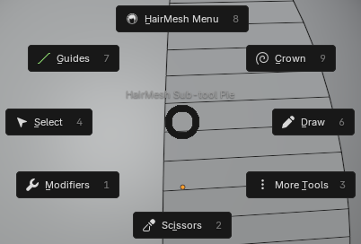
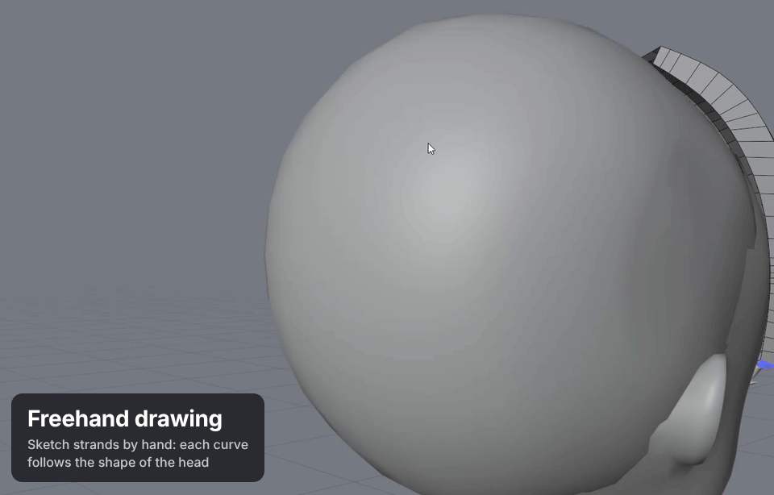
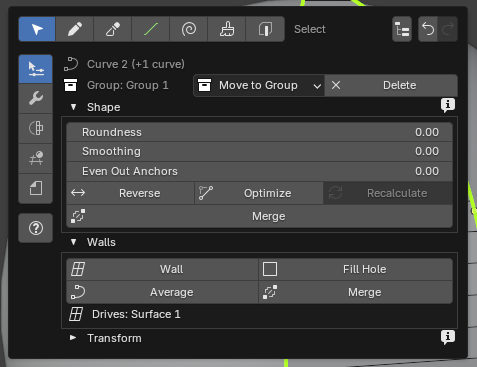

# Tools

HairMesh is one tool in the Object Mode toolbar, with sub-tools inside it. This page says what each sub-tool, menu and
pie is for. For the order of work, see [Workflow](workflow.md). For every key, see [Shortcuts](shortcuts.md).

Turn the tool on with **Shift+Alt+H** in Object Mode. Pressed again, it goes back to the tool you
used before. The **Tool: on** / **Tool: off** button of the Project panel in the HairMesh tab of the sidebar does the
same. Its header shows the sub-tools as icons, the HairMesh Menu, the
project, **Set Head** (once a head is set, it shows **Head:** and the head's name), **Convert** and, once there are meshes, **Live** and **Baked**.

## Switching sub-tools

Press **Q** for the sub-tool pie. Click an item, or press the number the pie shows beside it on the numpad:

| Direction | Numpad | Item |
|---|---|---|
| Left | 4 | Select |
| Right | 6 | Draw |
| Bottom | 2 | Scissors |
| Top | 8 | HairMesh Menu |
| Top left | 7 | Guides |
| Top right | 9 | Crown |
| Bottom left | 1 | Modifiers: the HairMesh Menu on its Modifiers tab |
| Bottom right | 3 | More Tools: Brush, Edges, HairMesh Outliner |

<!-- claims subtool-pie: pie.W=Select pie.E=Draw pie.S=Scissors pie.N="HairMesh Menu" pie.SE="More Tools" -->

Without opening the pie, these keys switch directly (the number row, not the numpad):

| Key | Sub-tool |
|---|---|
| 1 | Select |
| 2 | Draw |
| 3 or K | Scissors |
| 4 | Guides |
| 5 | Crown |
| 6 | Modifiers (the HairMesh Menu on its Modifiers tab) |
| M | Brush |
| V | Edges |

The icons in the tool header switch sub-tools too. **Esc** goes back to Select from most sub-tools.

## Select

For picking and moving anchors, curves, walls, guides, crowns and converted meshes.

- **Click** selects; **Shift+click** adds; a **box** selects anchors; a click in empty space clears the selection.
- **Double-click** a curve to select its anchors (again: the curve).
- **Drag an anchor** to move it. Hold **Shift** to slide it along the curve, **Alt** to follow the head surface.
- **Right-click a curve** to insert an anchor there.
- **Drag with the right button from empty space** to draw a line: an anchor goes in wherever it crosses a selected
  curve (every shown curve when none is selected), and the shape stays. The new anchors become the selection. A plain
  right click still opens Blender's context menu, when you let go. It works in every sub-tool except Draw and
  Scissors.
- **B + drag** sets the smoothness of the selected anchors.
- **C** is Circle Select.
- **G**, **R**, **S** (**Move Selection**, **Rotate Selection**, **Scale Selection**) move, rotate and scale the
  selection (anchors, curves, walls or groups). Converted meshes in the
  selection move with it. X, Y and Z lock an axis; type a value; **Esc** cancels.
- **E** extrudes a curve from its selected first or last anchor: a new anchor follows the mouse as with **G**. Click
  confirms; **Esc** or right-click takes it away. Several selected ends grow together. An end shared with another curve
  does not extrude: the status bar says why. To weld the new anchor to another curve, drop it on an anchor of that
  curve: the weld pie opens, as with a drag.
- **Extrude Curve** is the same action in **Weld / Split / Curves** (see below).
- **H** hides the selection, **Shift+H** hides everything else, **Alt+H** shows it all again. The actions are
  **Hide Selected**, **Hide Unselected** and **Reveal Hidden**. They use the eye of the HairMesh Outliner, and they are
  in **Object > HairMesh** too.
- **F** (**Frame Selection**) frames the selection.

**Drag on Head** (Viewport tab) makes dragged anchors follow the head surface all the time.

### The gizmo

Press **W** for the Move gizmo on the selection. The **Gizmo** menu (bottom right of the Shift+RMB pie, when the
selection can move) and the **Transform** block of the sheets also have the **Rotate Gizmo** and the **Scale Gizmo**,
**World Axes** or **Local Axes**, **Lock X / Y / Z**, and **Duplicate**. A lock hides the handles of its axis, so the
gizmo never moves along it. While dragging a handle, **Ctrl** scales uniformly and **Shift**
gives finer steps.

## Draw

For drawing new curves on the head. Press **2**.

The Draw page (HairMesh Menu, Selection tab) sets:

- **New Curves Go To**: the group that gets the next curve, with **Change Group**;
- **New Anchors**: **Smooth** or **Sharp**;
- **Mode**: **Anchors**, **Freehand** or **Lock**.

### Anchors mode

Each click places an anchor on the head. A ghost line follows the cursor. **Enter** or a right-click finishes the
curve; **Esc** finishes it and goes back to Select. Off the head, the anchor goes on a plane facing the view.

### Freehand mode

Drag a stroke. When you release, it becomes one curve. **Esc** during a stroke cancels it. Between strokes you can
navigate, undo and open pies as usual.

Freehand has three more settings:

- **Project On**: **Surface** lands on what is nearest to the camera (the head or a mesh), to add a layer over the
  hair; **Head** lands on the head alone, to draw close to the skull. It needs a visible head.
- **Distance from Head**: how far the finished curve sits off the surface.
- **Simplify**: fewer anchors and a smoother curve.

To join two strokes with a wall, select both, then **Walls / Lock** in the Shift+RMB pie.

### Lock mode

Draws a flat lock: a flat ribbon of hair. The curve you draw is its middle line, and the circle at the cursor is its
width. The page shows **Width** and **Starts**, which says how the next lock starts:

- **Free**: with no anchors selected, a lock of its own;
- **Between 2 Anchors**: with two anchors of other curves selected, a lock between them;
- **Branch From N Anchors**: with three or more selected, a volume branch.

Its sheets are described under [Flat Lock and Volume Branch](#flat-lock-and-volume-branch).

## Scissors

For cutting. Press **3** or **K**. The header and the page have three modes.

- **Curve:** pick curves (click, or select them before), then drag a line across them. A pie asks how: **Split into Two
  Curves**, **Split, Delete the Upper Part**, or **Split, Delete the Lower Part**. The shape is kept. A wall between
  two cut curves is cut too (cut the whole lock and it stays a lock); a wall with only one of its curves cut is deleted.
- **Wall:** click the wall to cut. Click one of its curves where the cut starts, click on the wall to add anchors, and
  click its other curve to end the cut. Press **Enter** (or Shift+RMB > **Cut**) to split the wall in two along a new
  curve. **Backspace** removes the last anchor; **Esc** cancels. The page and the pie have the same three actions:
  **Cut the Wall** (it says how many anchors the new curve has), **Remove the Last Anchor** and **Cancel**.
- **Split Ends:** click a curve and, from there to its tip, it splits into two branches (a Y: the new curve shares the
  trunk). A preview shows both branches under the pointer. The circle at the cursor is the **Spread** (the field of the
  page), in screen pixels: it sets how far the two ends move apart. Change it with **[** and **]**, with **F**, or with
  **Ctrl + right drag**. The right button picks a curve, as in the Curve mode.

## Guides

For steering the loops of the conversion. Press **4**. Three modes:

- **Line:** drag a line across the selected curves (none selected: every visible one).
- **NURBS Disc:** click on the hair for a ring around the head at that height. **Create NURBS Disc** makes one around the
  selected curves.
- **Pencil:** hold the left button and draw a loop around the hair. **Enter** closes it, **Esc** cancels.

The page shows the sheet of the selected guide (Influence Radius, Blend, Loop Density, Priority; for a disc, the ring
radii and **Reset Deformations**), or **Settings for New Guides**. The Shift+RMB pie of a guide line has
**Select Crossed Curves**. **Delete Guide** (the sheet and the pie) removes only that guide: the curves stay, and the locks it
shaped are rebuilt without it.

The **Groups** block of a guide sheet is its **Guide Group List**. **Exclude Listed** makes the guide leave the listed
groups alone; **Only Listed** makes it shape only them (an empty list: every lock). **Exclude a Group** (or **Add a
Group (Only)**) adds a group the guide crosses, and the X beside a name takes it off. In the HairMesh Outliner, the
power button of a guide (**Guide On / Off**) switches its effect on the loops off without deleting it; on a group, it
does the same for every guide inside. With a ring of a disc selected, its pie has **Select the Disc**.

## Crown

For the hair around the whorl and the parting. Press **5**.

- Click on the head where the whorl should be, or click **Create Crown**.
- **Symmetric (New Crowns)** mirrors new crowns across the head's center.
- Drag a lock curve's end onto a connector to open the Attach pie: **Attach to the Connector** (the item names the
  connector) or **Don't Attach**. **Ctrl+drag** slides an attached anchor; **Ctrl+click** detaches it. The anchor pie
  has the same as **Detach from the Connector** for an anchor attached to a connector.

The Shift+RMB pie of a crown selects its **Parting Line**, **Lower Connector** and **Crown Curves**, and has **+ Crown
Curve**, **Delete Crown**, symmetry and **Rings**. **+ Crown Curve** adds a curve in the middle of the widest gap
between the crown curves, shaped like its neighbors.

**Symmetric** (the sheet and the pie) opens a pie at the pointer to choose which half is copied onto the other:
**Left (+X) → Right (−X)** or **Right (−X) → Left (+X)**. After that, moving an anchor on either side moves its pair.
With the symmetry on, the button is **Symmetry Off** in the pie, and **Mirror Again** (in the sheet) copies one half onto
the other once more, for curves you added on one side.

## Brush

For reshaping many anchors at once. Press **M**, or More Tools in the Q pie.

- **LMB drag:** the anchors under the circle follow, softer toward its rim.
- **Shift:** smooth. **Ctrl:** inflate the lock. **Ctrl+Alt:** shrink it.
- **Mode**: **Screen** moves everything inside the circle; **Surface** moves only the hair nearest the touched point.
- **[** and **]** or **F** change the radius, **Shift+F** the hardness, **Ctrl + right drag** both.

With curves or a NURBS disc selected, only their anchors move. **Esc** goes back to Select.

## Edges

For making curves from the edges of a converted mesh. Press **V**, or More Tools in the Q pie.

- **Click** picks an edge; **Shift+click** adds.
- **Double-click** picks the edge loop, up to a fork.
- **Ctrl+click** takes an edge off; **Ctrl+drag** takes off a box.
- **Ctrl+Shift+click** picks the shortest path from the last edge.
- **Path → Curve** (page or Shift+RMB pie) turns the path into a curve.
- **Deselect** (page or pie) drops the picked edges.

**Esc** deselects the edges, then goes back to Select.

## Modifiers tab and the profile editor

Press **6** to open the HairMesh Menu on the **Modifiers** tab, with any sub-tool. It has three pages: **Profile**,
**Extra** and **Topology**. See [Workflow](workflow.md#modifiers) for what each one does.

### Profile page and sheet

On the Profile page, pick a preset and click **Apply** (**Apply to N Curves** with several curves selected). It sweeps
the profile along the selected curves, and each gets a Profile modifier. The icons beside the preset menu are **Edit
Profile**, **Save Preset...** (kept in the add-on preferences) and **Delete Preset**.

The sheet of a Profile modifier has:

- **Start**, **Middle** and **End**, each with **Radius** and **Rotation**. **= Start Profile** and **= Middle
  Profile** (Same Profile) make that part's profile the same as the one before it;
- **Collapse the Tip** and **Tip Length**, and **Loop Step**;
- **Auto Radius**: sets the radius from the width of the existing locks (or the curve length);
- **Copy Modifier** and **Paste Modifier**: the paste puts the copied profile and settings on the selected curves (a
  curve without a modifier gets one). **Paste Modifier** is also on the sheet of a curve while one is copied;
- **Convert to Curves & Walls**: makes a curve along every corner of the profile and walls between them, and deletes
  the modifier and its source curve;
- **Delete Modifier**, and in the pie **Its Curve**, which selects the source curve.

### Profile editor

Open it with the **Edit Profile** icon on the Profile page, or **Edit Profiles** on the sheet of a Profile modifier. It
draws one frame over the viewport for the page's profile, or three (Start, Middle, End) for a modifier.

- Click a point to select it: it turns orange and gets a white ring. **Shift+click** adds it to the selection or takes
  it out, and a click on nothing inside a frame deselects. Drag a point to move it (**Shift** snaps to a grid).
- Points that come close stick together; **Ctrl+drag** pulls them apart.
- Right-click an edge to add a point; the new point becomes the selection. Double-click a point to delete it, or press
  **X** or **Delete** to delete the selected points (with none selected, the point under the pointer). A profile keeps
  at least 3 points.
- **Ctrl+Z** and **Ctrl+Shift+Z** undo and redo inside the editor, with the selection each edit had.
- **Enter**, **Esc** or a click outside closes it.

### Extras and the weight brush

On the Extra page, the **+** icons add **Mask**, **Thickness**, **Twist**, **Noise** or **Curls** to the selected
modifier. The list below works like Blender's modifier stack: click a row to make that Extra active, use the eye to
switch it off, the X to delete it (**Delete Extra**). The **+** icons are **Add Extra**.

The sheet of a Mask has **Affects Only**, a list of the Extras the mask works on: **Add to the List** adds one, the X
beside a name takes it out, and an empty list means all of them. **Clear** sets the whole mask to 0, **Fill** to 100%,
and **Invert** turns every weight to 100% minus itself.

The brush button paints the active Extra (Mask, Thickness or Twist). With it on, the page shows **Mode**, the strength,
**Radius** and **Hardness**. LMB paints, **Shift** smooths, and **Ctrl** / **Ctrl+Alt** erase or invert depending on
the Extra (see [Shortcuts](shortcuts.md)). The paint shows on the live mesh in Solid view.

The brush stays on until you press **Esc**, click its button again, or change the page, tab or sub-tool.

### Topology page

Pick **Cap**, **Fill** or **Density**, set the values for the new item and click **Add Cap**, **Add Fill Holes** or
**Add Density** (the button names the group it adds to). The sheet of each item:

- **Cap**: **Fill** (**Quads**, **Collapse to a Point** or **Fewest Triangles**), **Start (Root)**, **End (If Open)**,
  **Size**, **Segments** and **Roundness**;
- **Fill Holes**: **Also Between Open Curves**, **Bulge**, and **Convert to Walls**, which turns the previewed walls
  into real ones;
- **Density**: the **Density** value, the **Density Brush** and **Clear Mask**.

### Density brush

On the Topology page, a Density item has its own **Density Brush**: LMB adds density, **Ctrl** erases, **Shift**
smooths. The loops are rebuilt when you release. **Clear Mask** removes the painted mask; the Density does nothing
until it is painted again.

## The HairMesh Menu (D)

<!-- claims menu: selected_curves=2 subtool=SELECT -->

Press **D**. The top row has the sub-tools, the HairMesh Outliner, and **Undo** / **Redo** (Ctrl+Z does not reach
Blender while a pop-up is open). The tabs on the left:

- **Selection:** the page of the active sub-tool (Draw, Scissors, Guides, Crown, Brush, Edges) and the sheet of what
  is selected: anchors, curves, a wall, a group, a guide, a crown, a mesh. With nothing selected: **New Group**.
- **Modifiers:** Profile, Extra and Topology.
- **Conversion:** the ticked groups, the sliders, **Convert**, **Confirm**, **Cancel**, **Live**, **Baked**.
- **Viewport:** **Live Preview** (with **Rebuild Live Preview** beside it: it rebuilds the walls' preview now),
  **Drag on Head**, **X-Ray** and **Guide Opacity**.
- **Project:** the project's file, **Set Head**, **Save** / **Save As...**, **Import...**, **New...**, **Migrate Hair
  from .hairmesh...**.

The **?** below the tabs shows the How To of the current sub-tool or page; click it for the full text.

Settings are grouped in blocks you can open and close. A dimmed control explains why in its tooltip, or in the **i** at
the right of its block's title.

The same menu is in **Object > HairMesh** as a plain list, and many sheets are in the **HairMesh** tab of the sidebar
(N).

### The Conversion tab

For the order of work, see [Workflow](workflow.md#conversion). What each control is:

- **Tick Top Groups** ticks only the top groups: one mesh per tree, the sub-groups merged into it. **Tick Every
  Group** ticks every group: one mesh each. **Uncheck All** ticks none, and the sliders then edit the project defaults.
  **Expand / Collapse All** opens every group of the list, or closes them all when they are all open.
- Each row has a tick and an **Only This Group** button, which ticks that group alone.
- **Loop Step** is the distance between neighboring loops. The icon beside it, **Loop Step from Object Height**, takes
  the height of the active Blender object as the loop step.
- **Loop Direction** sets the direction of the loops: 0 is horizontal (aligned across locks), 1 is perpendicular to
  the lock. Steep parts stay aligned across locks either way.
- **Detail Proxy** is a checkbox, on by default. Where a lock has detail on it (a dent, a groove, curves forking inside
  it), the loops are placed as on the simple tube around the detail and carried over to the detailed curves, so they no
  longer run in chevrons along it. Untick it to get the loops of older versions. It is also in a group's sheet.
- **Merge Shared Trunks** is a checkbox. Where locks run along welded curves (a common trunk), it welds their
  coincident vertices and removes the double walls.
- **Merge Distance** is how far apart the vertices of such locks may lie to be welded into one. Convert reads it only
  with Merge Shared Trunks on; when nothing reads it now, the field is dimmed and its tooltip says why. **Auto** sets it back to a quarter of the loop step.
  **Pick** starts a circle at the cursor in the 3D View: click to set the distance to the circle's diameter, measured
  where it is. Ctrl+wheel and Ctrl + right drag change the circle's size; **Esc** or the right button cancels.
- **Match Project** (in a group's sheet, beside its Loop Step) recalculates that group, and the groups inside it, with
  the project's loop step. It is dimmed when they already have it.

### Sheets of the Selection tab

The Selection tab shows a sheet for the last selected item, in blocks you can open and close:

- **Anchors:** the count, **Delete Anchors**, **Delete Anchors, Keep Shape**, **Shape** (**Smoothness**, and
  Recalculate Handles as an icon), **Weld / Split / Curves** (see [below](#weld--split--curves)), **Flat Lock at the
  Anchor** for the anchors of a flat lock, and **Transform**.
- **A curve:** its name and group, **Move to Group** and **Delete Curve**, **Shape** (**Roundness**, **Smoothing**,
  **Even Out Anchors**, **Reverse Direction**, **Optimize Anchors**, **Recalculate All Anchors**, and **Merge
  Coincident Anchors** with two or more curves), **Walls** (the wall items of the Walls / Lock menu, **Unite Locks**,
  and a "Drives:" line naming the walls these curves drive), and **Transform**. A curve with a Profile modifier has a
  button to its sheet, **Its Modifier**. The sheet of a flat lock also has the [Flat Lock](#flat-lock-and-volume-branch)
  block.
- **A wall:** its name, its group and the curves it joins, **Move to Group**, **Delete Wall**, **Unite Locks** when
  the selection has locks that run into each other, and **Shape**: **Bulge**, **Width Segments**, **Segment Offset**,
  **Spread from Center**, **Bulge to the Other Side**, **Clean Topology**, **Second Surface** and, with width segments,
  **Segments to Curves**. See [Workflow](workflow.md#walls).
- **A group:** see below.

#### Group sheet

- The name, the color swatch, **Clear Color** (it only shows while the group has a color of its own) and the eye.
  A color covered by a group above says "Color from <group>" beside a dimmed swatch.
- **New Sub-group**, **Rename...**, **Delete**.
- The group the item lives in, and **Move to Group**: it lists the root level and every group, and clicking one runs
  Move Selection to Group. At its top are **Parent to Last Selected Group (P)** and **Unparent to Root (Shift+P)**,
  dimmed when the selection does not fit.
- **Detach** (Detach from Neighboring Groups) gives the curves of this group that are welded to curves of other groups
  anchors of their own there. Welds inside the group stay. It is dimmed when there is nothing to detach.
- **Separate X Junctions (N)** cuts the locks of the group across at every X junction that has walls across it, where
  curves cross or welded strands swap partners. The walls above and below become separate locks, their loops built
  independently, joined only at the cut. The curves stay whole; the new walls run on edge curves that follow them. N is
  how many such junctions there are. The button only shows when there is one.
- **Recalculate Glued Locks (N)** shows when two or more locks of the group are welded to each other. Curves that wander
  off a shared stretch and come back are welded onto it, then every pair of facing walls is replaced from the fork, as
  with Unite Locks.
- **Display**: **Curves** (Auto, Show or Hide) and **Free Curves**.
- **Conversion — This Group Only**: **Convert This Group** (a group converted with a group above shows **Converted with
  a Group Above**, dimmed), **Loop Step** with **Match Project**, the sliders, **Detail Proxy**, **Merge Shared Trunks**
  and **Container**. These edit this group alone.
- **Symmetry** (closed by default): the checkbox in the header, **Axis** (X, Y or Z) and **Apply Symmetry**. The
  mirrored half shows live while you edit, and goes into the mesh on Convert. A group converted inside a group above
  it (for example after **Tick Top Groups**) goes into that group's mesh, which is mirrored by that group's Symmetry;
  the **i** of the block says so. **Apply Symmetry** makes it real,
  editable curves and walls now, in a group named "<group> mirror" right after this one, and turns the Symmetry off. It
  is dimmed while the Symmetry is off. Put the anchors that must meet their mirror on the plane first, with **Snap to
  Mirror Plane**.

#### Flat Lock and Volume Branch

The curve sheet of a flat lock has a block named **Flat Lock**, or **Volume Branch (N Anchors)** for a branch. To make
one, use the Lock mode of [Draw](#lock-mode).

- **Profile Smoothing** and **Tip**.
- On a flat lock (not a branch), three sections for the ribbon. **Extrude** pushes the ribbon out (orange), **Offset**
  moves the extruded edges in (orange) or out (blue), and **Glue** closes the top face of the extrusion (green; at 100%
  its two edges become one, a Y profile). Each has a **Brush** button and **Clear**, which removes what you painted.
  The paint shows as color on the ribbon. **Depth**, **Invert** and **Fade to Tip** shape the extrusion. Offset has its
  own **Fade to Tip**. While a brush runs, its **Strength** (**Intensity** for Offset) shows. They are dimmed until
  Extrude is painted; the **i** says why.
- **Convert to Curves & Walls** turns the lock into curves along the edges of the ribbon (and of its extrusion) and
  walls between them, and deletes the middle curve. **Plain Curve** drops the lock and keeps its curve as an ordinary
  curve. Both are also in **Walls / Lock** with a flat lock selected.

The anchor sheet of a flat lock has **Flat Lock at the Anchor**: **Width** (the whole width of the ribbon there) and
**Rotation**. At the root of a lock started from anchors both are dimmed, because its shape follows those anchors.

## The Shift+RMB pie

Press **Shift+RMB** for a pie that matches the selection. The HairMesh Menu is always at the top right. With something
selected, Delete is at the bottom, and the Gizmo menu is at the bottom right when the selection can move.

- **Anchors:** Delete Anchors, Delete Anchors, Keep Shape, Recalculate Handles, Duplicate, Smoothness, and **Weld /
  Split / Curves**.
- **Curves:** Reverse Direction, Optimize Anchors, Delete, Roundness / Smoothing / Even Out, Move to Group, and **Walls
  / Lock**.
- **A wall:** select its curves, Delete Wall, Bulge, Width Segments, Flip, Clean, and **Walls / Lock**.
- **A group:** New Sub-group, Rename Group..., Delete Group, Visible and Curves mode, Move to Group, Conversion.
- **A converted mesh:** Confirm / Cancel (while pending) or Live / Baked, Delete Mesh, Convert, Select Source Group.
- **A guide, a disc, a crown, a modifier, a Cap / Fill / Density:** their own actions and values.
- **Nothing selected:** New Group, Convert, Live Preview, the Live / Baked switch, Drag on Head, Save .hairmesh, and
  the HairMesh Outliner. While a conversion is pending, Cancel and Confirm take the place of Live Preview and the
  switch. Without a project: Import .hairmesh and New Project.

Items that do not apply leave their direction empty. Selections that a click cannot give at once (the curves of a wall,
the curves a guide crosses, the parts of a crown, the disc of a ring) are in this pie.

### Weld / Split / Curves

The south-west item of the anchor pie. The **Weld / Split / Curves** block of the anchor sheet has the same actions
with shorter names. An item that does not apply is left out of the pie; in the sheet it is dimmed, and its tooltip says
why.

- **Create Curve Between the Anchors**: with exactly two anchors selected. The
  new curve is welded to both, and shares the trunks of the curves it joins.
- **Create Curve Through the Anchors (N)**: with two or more. A free curve through them in the
  order you picked them, welded to nothing.
- **Select Lock Curves (N)** (the pie only): selects every curve of the lock the anchors belong to. It is left out
  when it would select nothing new.
- **Extrude Curve**: the same as **E**. Dimmed where no selected anchor can grow (a middle anchor, a welded end); the
  tooltip says why.
- **Snap to Mirror Plane**: puts the selected anchors exactly on the symmetry plane, so Apply Symmetry keeps them
  shared between both halves. Only the coordinate along the axis changes. The plane is the one of the Symmetry of the
  anchor's group (or of a group above it); with no Symmetry, the head center's X. It is dimmed when every selected
  anchor already lies on the plane. In the block, the button reads **Snap to Plane**.
- **Separate Zones at This X**: only when the last selected anchor is an X junction with walls across it. The walls
  above and below become separate locks, joined only at the cut. The curves stay whole, and the new walls run on edge
  curves that follow them.
- **Optimize Selected Anchors**: removes selected anchors one by one while the curves keep their shape. The ends,
  junctions and attached anchors stay.
- **Split Curve at the Anchor**: splits every curve that runs through the last selected
  anchor in two there. It shows only where a curve runs through the anchor, not ends there.
- **Unweld from**: a submenu with the curves that share the last selected anchor. Choosing one gives that curve an
  anchor of its own there (**Unweld Anchor**); the other curves stay welded to each other. **Ctrl+click** on a welded
  anchor of a selected curve does the same.
- **Rotate Junction**: for a junction with three or more directions. Pick the curve that passes smoothly through it;
  the others leave along its tangent. **Automatic** goes back to the automatic tangents.
- **Detach from the Connector**: for an anchor attached to a crown connector.
- **Detect Fill Outline Here**, at the end after a line (see below).

### Walls / Lock

The south-west item of the curve and wall pies. The **Walls** block of the curve sheet has the wall-making items. The
menu follows the selection:

- With two or more curves: **Create Wall** (two curves) or **Walls Between N Curves (Open)**; **Wall Between Exactly
  These Two Curves** when the curves have trunks; **Volume Lock from N Curves (Closed)** (three or more);
  **Fill the Hole Between These Curves** (**Fill Hole** in the rows of the HairMesh Menu); **Create Average Curve** (two curves); **Merge Anchors at Identical Places**.
  Two curves joined in an X start with **Create Walls Around the X** (a wall per zone, the curves stay whole) and **One
  Wall Through the X**.
- **Guide Line (Drag Across the Curves)** switches to the Guides sub-tool in its Line mode, with the curves still
  selected.
- **Unite Locks (Y / X Junction)** when the selection has two locks that run into each other.
- The walls the selected curves drive, one button each, named after the wall (**Select Wall**).
- **Select Lock Curves (N)**.
- With a flat lock selected: **Convert to Curves & Walls** and **Plain Curve**.
- With a wall selected: its name and its two curves, then **Select** and the curve's name for each curve, and **Select
  Both Curves** (these run Select Wall Curves), **Segments to Curves** when the wall has width segments, **Delete
  Wall**, **Select Lock Curves** and **Unite Locks**.

### Weld pie, and other pies that open by themselves

- **Weld pie:** drop a dragged anchor near another one. **Weld Anchors into One**, or **Don't Weld** to leave it where
  it is. When the start of one curve meets the end of another, the pie also has **Reverse <curve>, then Weld** and
  **Join into One Curve**: the curve that ends there goes on with the other one's anchors, and the other one is gone.
- **Attach pie:** a lock curve's end dropped near a crown connector. See [Crown](#crown).
- **Cut pies:** the Scissors' Curve mode asks how to split; the Wall mode's pie holds the cut. See
  [Scissors](#scissors).

### Detect Fill Outline Here

In the Shift+RMB pie opened over the 3D View: with nothing selected it takes the east direction while there is no
Live / Baked switch to show (no converted mesh yet), and it is the last item of **Weld / Split / Curves** and of
**Walls / Lock**. It lights up the outline under the pointer in light blue: two curves, or a hole in the walls. A
confirmation pie opens with **Cancel** at the west and **Fill the Highlighted Outline** at the east, and filling is
one undo step. The outline goes away however the pie closes.

## The HairMesh Outliner (O)

Press **O** for the project tree: head, groups, curves, walls and everything else, with eyes, curves mode, colors and
conversion ticks. It is where you select a group. See [Workflow](workflow.md#groups-and-the-outliner).

- **The bar:** the name field of the selected item (type to rename it), **Expand / Collapse All**, **Reveal in
  HairMesh Outliner** (opens the groups down to the selected item), **New Group**, **Cut** and **Paste** (to move items into another group) and
  **Delete**. In the pop-up it also has **Undo** and **Redo**. A filter field and a summary line are under the rows.
- **The columns of a group row:** the loop step, the **Group Curves Mode** button (it goes Auto, Show, Hide and back to
  Auto), the color swatch, the Container tag, the power button **Guide On / Off** (only while a guide, or a group
  holding guides, is in the list), the conversion tick, the arrow that moves the selection into the group (it becomes
  **Paste** while something is cut) and the eye.
- The eye of a wall hides that wall alone in the live mesh. The eye of the head hides the head object too.
