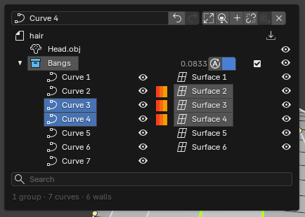

# Workflow

This page walks through the whole flow, task by task. New to HairMesh? Start with [Getting Started](getting-started.md).
Keys are listed in [Shortcuts](shortcuts.md); the sub-tools are described in [Tools](tools.md).

All of this happens with the HairMesh tool active (**Shift+Alt+H**, Object Mode). Most actions are in two places:

- the **HairMesh Menu** (**D**), whose Selection tab shows the settings and actions of what you selected;
- the **pie** (**Shift+RMB**), which changes with the selection.

The **?** below the tabs of the HairMesh Menu shows a short How To for the sub-tool or page you are on.

## The idea

1. **Curves** run over the head along the hair.
2. **Walls** stretch between neighboring curves. A row of walls is a **lock**.
3. **Convert** turns the locks of the ticked groups into a quad mesh with evenly spread loops.
4. You keep editing the curves and convert again. The curves and walls are the source; the meshes are the result.

## Curves

**Draw.** Press **2** and click along the head; **Enter** finishes the curve. Or switch the Draw page to **Freehand** and
drag strokes. The Draw page (D, Selection tab, with Draw active) also sets where new curves go (**New Curves Go To**,
**Change Group**) and whether new anchors are **Smooth** or **Sharp**.

**Select and move.** In Select (**1**), click an anchor or a curve. **Shift+click** adds. Drag a box to select anchors.
Double-click a curve to select all its anchors. Drag an anchor to move it; hold **Shift** to slide it along the curve,
**Alt** to follow the head surface. **G**, **R** and **S** move, rotate and scale the selection.

**Shape.** With curves selected, the Selection tab has **Roundness**, **Smoothing** and **Even Out Anchors**, plus
**Reverse**, **Optimize** and **Recalculate**. With anchors selected, set their **Smoothness**, or hold **B** and drag.

**Add and remove anchors.** Right-click a curve to insert an anchor there. **Delete Anchors, Keep Shape** removes anchors
without changing the curve's shape.

**Cut.** The Scissors (**3** or **K**) cut curves along a stroke, or cut a wall in two along a new curve.

**Brush.** The Brush (**M**) moves, smooths, inflates or shrinks the anchors under a circle.

## Walls

Select two or more curves, then open **Walls / Lock** in the Shift+RMB pie (the same items are in the **Walls** block
of the curve sheet in the Selection tab):

- **Create Wall** (or **Walls Between N Curves (Open)**) stretches walls between the curves, in selection order.
- **Volume Lock from N Curves (Closed)** also closes the last curve back to the first: a lock with volume.
- **Fill the Hole Between These Curves** fills a hole bounded by welded curves.
- **Create Average Curve** adds a curve halfway between two curves.
- **Merge Anchors at Identical Places** joins anchors that sit on the same spot.

Click a wall to select it. Its sheet has:

- **Bulge** (how far the wall bows out) and **Bulge to the Other Side**;
- **Width Segments**, with **Segment Offset** and **Spread from Center** when there are more;
- **Clean Topology**, for straight, even loops across the wall;
- **Second Surface**, a second wall between the same two curves with its own settings (needs a Bulge);
- **Segments to Curves**, which turns the segment lines into real curves.

Bulge only shapes a wall with Width Segments of 1 or more.

The Shift+RMB pie of a wall also selects its curves.

## Conversion

Press **D** and open the **Conversion** tab.

1. **Tick** the groups to convert in the list. **Tick Top Groups** makes one mesh per top group; **Tick Every Group**
   makes one mesh per group; **Uncheck All** clears the ticks. A new group starts ticked.
2. Set the sliders: **Loop Step**, **Deviation**, **Fix Sharp Angles**, **Loops Horiz ↔ Perp**, **Tips**, **Relax**,
   **Merge Shared Trunks**. They edit the ticked groups. The line above them says what Convert makes and which groups
   the sliders edit.
3. Click **Convert**. The new meshes appear in orange. This is a preview: change the sliders and it follows. Press
   **Esc** during a long conversion to stop it without changing anything.
4. Click **Confirm** to keep the meshes, or **Cancel** to drop them.

A group's own sheet (select the group in the Outliner) has the same sliders under **Conversion — This Group Only**,
plus **Convert This Group**, **Match Project** for the loop step, and **Container** (sub-groups inside are converted
each on its own).

### Live and Baked

- **Live**: the walls and curves are shown, the converted meshes hidden.
- **Baked**: the converted meshes are shown, the walls and curves they came from hidden.

The buttons are next to Convert, in the tool header, and in the Shift+RMB pie with nothing selected.

### Editing after a conversion

A confirmed mesh stays as it is when you edit the curves. The Conversion tab then says how many meshes changed. Click
**Convert** again: only those meshes are rebuilt, and **Confirm** replaces the old ones.

## Groups and the Outliner

Groups organize the hair and decide what becomes one mesh. Press **O** to open the HairMesh Outliner. It lists the head,
the groups as a tree and, inside each group, its curves and walls. The same tree is at the top of the HairMesh tab of
the sidebar (N).

- **Select:** click a name. **Shift+click** adds. **Ctrl+click** a group selects what is inside it. The Outliner is
  where you select a group.
- **Show or hide:** the eye of each row.
- **Curves mode:** **Auto** (curves and anchors show only while you work inside the group), **Show**, or **Hide**.
- **Color:** the swatch of a group colors its curves and meshes.
- **Conversion:** the tick of a group.
- **Move:** **Cut** and **Paste**, the arrow icon on a group row (it moves the selection into that group), or **Move to
  Group** in the menus. **P** puts the selection
  into the group selected last; **Shift+P** takes it out to the root level.
- **Rename:** **F2**, a double-click on the name, or the name field of the bar.
- **New Group**, **Delete**, **Expand / Collapse All** are in the bar.

You can also make a group with **New Group** in the Shift+RMB pie (nothing selected) or in the Selection tab. With a
group selected, the pie offers **New Sub-group**, **Rename Group...**, **Delete Group** and **Move to Group**.

### Hiding

**H** hides the selected items, **Shift+H** hides the rest, **Alt+H** shows everything HairMesh hid. They use the same
eye as the Outliner.

## Guides

Guides steer the loops of the conversion. Press **4** for the Guides sub-tool and pick a mode:

- **Line:** select curves first, then drag a line across them. The loops pass through the crossings. With nothing
  selected, it crosses every visible curve.
- **NURBS Disc:** click on the hair. A ring goes around the head at that height, and the curves through it get a guide
  loop. **Create NURBS Disc** makes one around the selected curves (or all the hair).
- **Pencil:** hold the left button and draw a loop around the hair. It closes when you get back to the start, or press
  **Enter**. **Esc** cancels.

Select a guide to edit **Influence Radius**, **Blend**, **Loop Density** and **Priority**. A disc also has **Outer
Radius**, **Inner Radius** and **Reset Deformations**. Click a ring of a disc in Select and move, rotate or scale it with
G, R, S or the gizmo. Without a guide selected, the page shows **Settings for New Guides**.

**Guide Opacity** (Viewport tab) sets how strongly guides show.

## Crowns

A crown builds the hair around the whorl and the parting. Press **5** for the Crown sub-tool.

1. Click on the head where the whorl should be. Or click **Create Crown** to fit one on the top of the head.
2. **Symmetric (New Crowns)** makes new crowns mirror across the head's center.
3. Drag the end of a lock curve onto a connector. All connectors show while you drag, with a green dot where the anchor
   would attach. Release to open the Attach pie.
4. **Ctrl+drag** slides an attached anchor along its connector; **Ctrl+click** detaches it.

With a crown selected, the Shift+RMB pie selects its **Parting Line**, **Lower Connector** or **Crown Curves**, adds a
**+ Crown Curve**, switches symmetry, and sets **Rings** (0 takes the value from the loop step).

## Symmetry and duplication

**Symmetry of a group.** Select a group and open its **Symmetry** block. Turn on **Symmetry** and pick the **Axis**.
The group is mirrored on Convert. **Apply Symmetry** turns the mirrored copy into real curves and walls in a new group
named "<group> mirror".

**Duplicate.** **Shift+D** duplicates the selected curves, walls and groups. Duplicate is also in the **Transform**
block of the sheets.

## Welds and junctions

**Weld.** Drag an anchor and release it near another anchor. A pie opens:

- **Weld Anchors into One**, or **Don't Weld**;
- when the start of one curve meets the end of another: **Reverse <curve>, then Weld** or **Join into One Curve**.

The **Weld / Split / Curves** submenu of the anchor pie (also a block of the anchor sheet) has more:
**Create Curve Between the Anchors**, **Create Curve Through the Anchors**, **Optimize Selected Anchors**, **Split Curve
at the Anchor**, **Unweld from**, and **Rotate Junction**. **Ctrl+click** a welded anchor of a selected curve to unweld
it.

**Junctions.** Select locks that run into each other and click **Unite Locks (Y / X Junction)** (Walls / Lock menu, or
the curve and wall sheets). Their facing edges become one common trunk and new walls close the inner sides: a Y from
the root, an X in the middle.

## Modifiers

Press **6** (or **Modifiers** in the Q pie) to open the HairMesh Menu on its **Modifiers** tab. It has three pages.

### Profile: sweep a shape along a curve

1. Draw a curve and select it.
2. Pick a profile in the preset menu: **Quad**, **Trapezoid**, **Triangle**, **Circle**, **Half Circle**, or one you
   saved.
3. Click **Apply**.

The surface follows the curve as you edit it. Select the modifier to edit it:

- **Start**, **Middle** and **End**, each with its own profile, **Radius** and **Rotation** (three profiles along the
  lock), with **= Start Profile** / **= Middle Profile** to copy one onto the next;
- **Edit Profiles** opens the profile editor on the three;
- **Collapse the Tip** and **Tip Length**;
- **Auto Radius**, **Loop Step** (0 uses the group's);
- **Copy Modifier** / **Paste Modifier**;
- **Convert to Curves & Walls**, which turns it into ordinary curves and walls.

On the Profile page, the icons next to the preset menu open the profile editor (**Edit Profile**), **Save Preset...**
and **Delete Preset**. Saved presets live in the add-on's preferences.

### Extra: mask, thickness, twist, noise, curls

Extras sit on top of a Profile modifier. Select the modifier (or its curve) and click one of the five **+** icons:
**Mask**, **Thickness**, **Twist**, **Noise** or **Curls**.

The page lists the Extras of the modifier, like Blender's modifier stack: click one to make it active, use its eye to
switch it off, its X to delete it.

Mask, Thickness and Twist are painted with the **weight brush**. Turn on the brush button of the active Extra and paint
on the surface:

- **Mask:** LMB paints, **Ctrl** erases, **Shift** smooths.
- **Thickness:** LMB paints, **Ctrl** inverts, **Ctrl+Alt** erases, **Shift** smooths.
- **Twist:** LMB twists one way, **Ctrl** the other way, **Ctrl+Alt** erases, **Shift** smooths.

**Clear** on the sheet erases all the paint. Noise and Curls are set with their sliders, not painted.

### Topology: cap, fill, density

These act on the locks of a whole group and its sub-groups. Pick **Cap**, **Fill** or **Density**, set the values for the
new item, and click **Add … to <group>**.

- **Cap** closes the ends of closed locks (a Volume Lock, or two curves with a Second Surface). It shows on the walls
  now and is built into the mesh on conversion.
- **Fill** (Fill Holes) previews walls over the gaps between the curves of a group that no wall covers. Check the
  preview, then click **Convert to Walls** on its sheet.
- **Density** gives more (or fewer) loops only where you paint it. Add it, set **Density**, then paint with the
  **Density Brush**. The loops update when you release.

Each item has an eye that switches it off.

## Importing a .hairmesh file

**File > Import > HairMesh Project (.hairmesh)** opens a project from the original app or one saved by HairMesh: curves,
groups and the head. The scale is automatic by default.

To bring the hair of another `.hairmesh` into the project you already have, use **File > Import > HairMesh: Migrate
Hair (.hairmesh)**, or **Migrate Hair from .hairmesh...** in the Project tab.

Want an example? Download the example file from the author's page, <https://boosty.to/catarackta>, and import it. It
does not ship with the add-on.

## The project lives in the .blend

The project is kept inside the `.blend` file. Save the `.blend` and everything comes back when you open it. The curves,
the live walls and the meshes are rebuilt from the project.

The **Project** tab of the HairMesh Menu also writes `.hairmesh` files: **Save .hairmesh** writes back to the file the
project came from, **Save .hairmesh As...** writes a new one. It also has **Set Head**, **Import .hairmesh...** and
**New Project...**.
